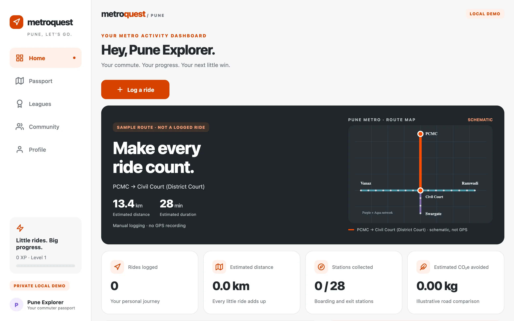
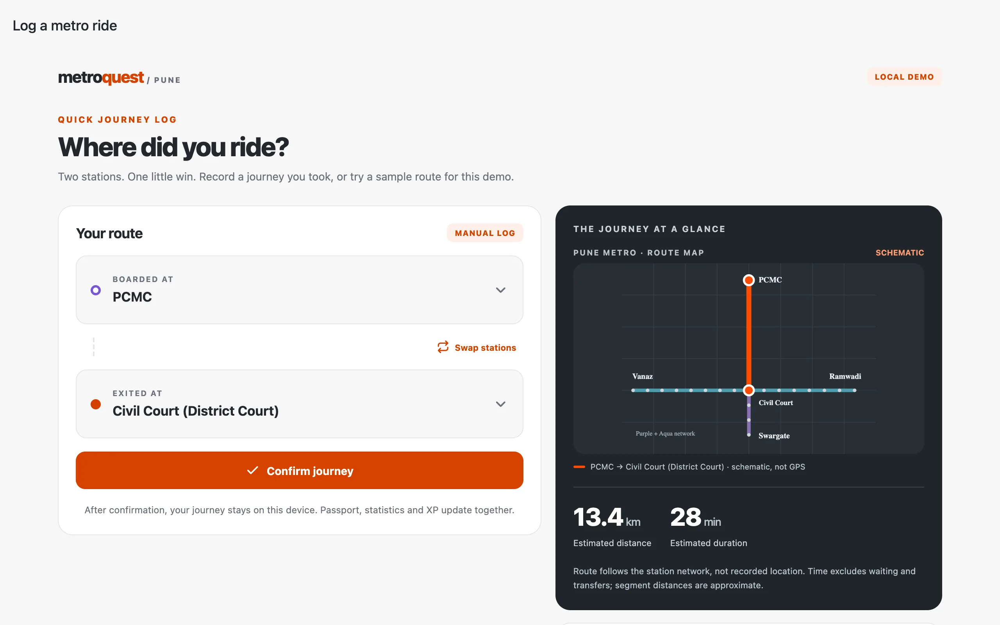
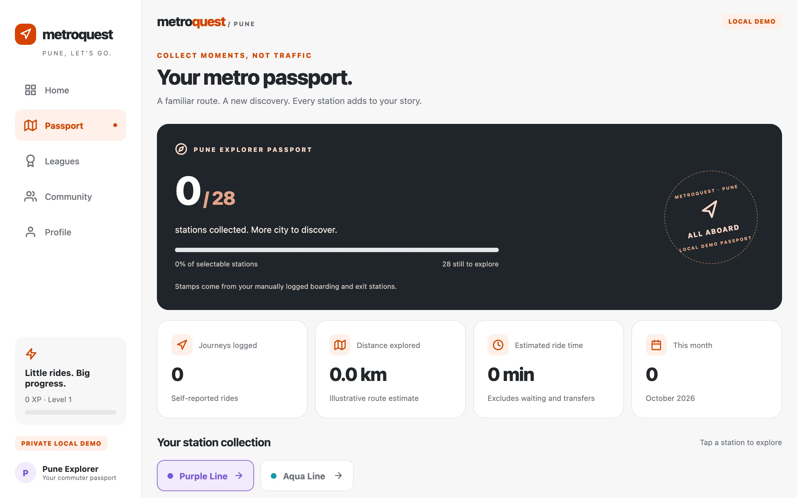
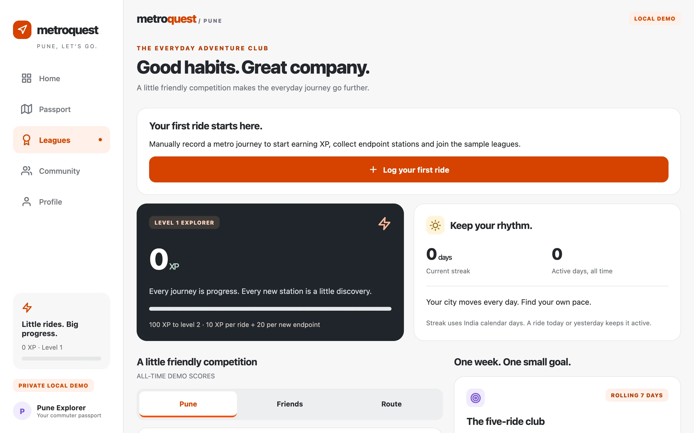
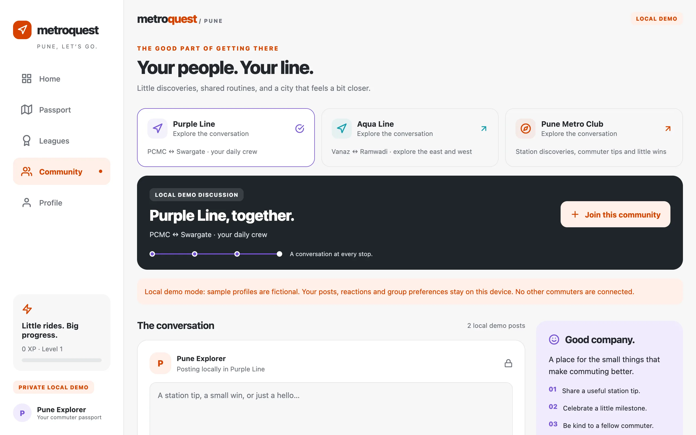

# MetroQuest · Pune

**Make every ride count.** A Strava-inspired local demo of a metro passport, journey tracker, sample XP leagues and route community — one Expo SDK 57 app for web, Android and iOS.

**Live demo:** [https://roojool.github.io/pune-metro-strava/](https://roojool.github.io/pune-metro-strava/)

[Repo](https://github.com/Roojool/pune-metro-strava) · [Five paste-ready developer prompts](team-prompts/) · [Verified team status](TEAM_STATUS.md) · [Demo guide](DEMO_GUIDE.md)

<div align="center">


[](https://roojool.github.io/pune-metro-strava/)

</div>

## Screenshots

Framed captures of the [live demo](https://roojool.github.io/pune-metro-strava/) (current UI, 2026-10-24). Fresh installs start at 0 rides / 0 XP; sample leagues and posts are labeled in-product.

<div align="center">











</div>

Also verified on an Android API 36 emulator with Expo Go 57.0.9:
[android-home.png](docs/screenshots/android-home.png). Physical phones and iOS
runtime testing remain untested; both native platform bundles export successfully.

## How to demo (≈2 minutes)

1. Open the [live demo](https://roojool.github.io/pune-metro-strava/) (or `npm run web` locally).
2. Tap **Log a ride**. Default **PCMC → Civil Court** is ready; confirm.
3. Check **Home** totals and **Passport** stamps (boarding + exit only; passed stations are not visits).
4. Open **Leagues**: your XP updates; other riders are **sample** identities — not a live city board.
5. Open **Community → Purple Line**: create a local post and react.
6. Reload the same origin/device — journeys, posts, reactions and preferences persist via AsyncStorage.

One-minute logging cooldown and a 10-ride/UTC-day cap reduce accidental duplicates. Use Profile’s two-step reset for a clean demo. Full walkthrough: [DEMO_GUIDE.md](DEMO_GUIDE.md).

## Real vs sample (honest limits)

| In the demo | What it is |
| --- | --- |
| Your logged rides, XP, passport stamps, posts, likes | Real **local** state on this browser/device |
| League board names / Friends / Route ranks | **SAMPLE / DEMO** — local simulation, not Pune rankings |
| Sample community identities | Labeled fiction for the UI |
| Station names & open status | Snapshot of the [official project profile](https://punemetrorail.org/project-profile) (checked 2026-10-24) |
| Distance / time / CO₂e / “savings” | Estimates & illustrative assumptions — not fare or measured emissions |
| Fare | **Unavailable** — use the [official fare checker](https://punemetrorail.org/fare_chart.aspx) |

All journeys are **manually self-reported**. No background GPS, authentication, remote social network or ticketing. Range Hill is not selectable. Distances use proportional segments of the official 17.4 km Purple / 15.7 km Aqua corridors. Details: [KNOWN_LIMITATIONS.md](KNOWN_LIMITATIONS.md).

## Run

Node 24 LTS and npm are recommended. **No external API keys required.**

```sh
npm ci
npm run start       # Expo QR for Android/iOS (Expo Go matching SDK 57)
npm run web         # Expo Web, normally http://localhost:8081
npm run typecheck
npm test
npm run export:web  # static web build in dist/
```

Expo SDK 57 is deliberate during the SDK 58 transition. Install Expo Go matching SDK 57; see https://expo.dev/go. Android/iPhone steps and the exact demo scenario: [DEMO_GUIDE.md](DEMO_GUIDE.md). Windows cannot run the iOS simulator.

## What the demo does

Log PCMC → Civil Court in the quick ride screen. Shared state updates Home,
endpoint station stamps, statistics, XP and achievements. Explore sample leagues,
open a Purple Line discussion, create a local post and react. Journeys, posts,
reactions, joined communities and profile preferences persist through reload on
the same browser origin/device using AsyncStorage.

First ride typically earns **50 XP** (10 ride + 20 for each new boarding/exit
endpoint). Route maps are schematic; they are not GPS tracks. Orange activity
accents pair with Purple/Aqua metro lines.

## Five humans, separate ownership

The five prompts include a continuing integration protocol. Opening a PR is a
checkpoint: verify while review is pending, address concrete failures, sync after
merge, and finish only after a real integrated browser pass.

After the current editing agent has stopped, its human can run this in that
developer's own checkout (replace `journey` with `passport`, `leagues` or
`community`):

```sh
git fetch origin
git merge origin/main
npm ci
npm run team:continue -- journey --minutes 30
```

The runner requires authenticated Codex CLI and GitHub CLI. It uses one checkout
lock, at most six agent calls, and a thirty-minute limit. It never self-merges or
bypasses required checks. Install dependencies in each checkout. Do not run it
alongside another editing agent. Existing active agents can instead read their
updated prompt and follow the same protocol directly.

`npm run verify:e2e` runs typecheck/tests/export, starts its own temporary static
server and browser, and checks the full ride/passport/league/community/reload
flow. Actual results are written to ignored `output/e2e-result.json`.
See [the continuation guide](docs/TEAM_CONTINUATION.md) and
[the shared integration board](INTEGRATION_BOARD.md).

| Developer | GitHub | Branch | Exclusive files |
| --- | --- | --- | --- |
| 1 Lead | Roojool | feature/core-integration | app/**, shared core/config/tests/CI/docs |
| 2 Journeys | prathadox | feature/journey-tracking | src/features/journey/** |
| 3 Passport | chetanpujari5105 | feature/passport-stats | src/features/passport/** |
| 4 Leagues | mangeshraut712 | feature/gamification | src/features/leagues/** |
| 5 Community | atharvamhaske | feature/community-web | src/features/community/** |

Copy your complete standalone prompt:

1. [Lead / integration](team-prompts/01-lead-integration.md)
2. [Journey tracking](team-prompts/02-journey-tracking.md)
3. [Passport / statistics](team-prompts/03-passport-statistics.md)
4. [Leagues / gamification](team-prompts/04-leaderboards-gamification.md)
5. [Community / web](team-prompts/05-community-web.md)

These plans are parallel and have no overlapping feature paths. Only the lead
edits shared state/models, package configuration, root routes, shared UI or CI.
All models/calculations are central; no feature implements another scoring or
storage system. Contracts freeze at minute 20. Root routes re-export the owned
feature screens, so contributors never need to edit navigation.

The revised delivery window was **14:15–15:15 IST, 2026-10-24**. Continue from
`main` after merges; pull before starting a lane.

AI coding helpers use **separate worktrees and ai/* branches**. Their feature
reservations are recorded in [TEAM_STATUS.md](TEAM_STATUS.md); human owners wait
for handoff before changing an AI-reserved feature. Humans can independently
inspect, test and review. Do not run two workers in one checkout or concurrently
assign a file to a human and AI. Human accounts, invitations and branches remain
separate from AI helpers. Lead reviews, checks and squash merges one PR at a time.

See [CONTRIBUTING.md](CONTRIBUTING.md), [ARCHITECTURE.md](ARCHITECTURE.md),
[SPRINT_120_MIN.md](SPRINT_120_MIN.md), [TEAM_STATUS.md](TEAM_STATUS.md) and
[AGENTS.md](AGENTS.md). License decision: [all rights reserved](LICENSE-NOTE.md).
The Supabase SQL is an unapplied draft only.
