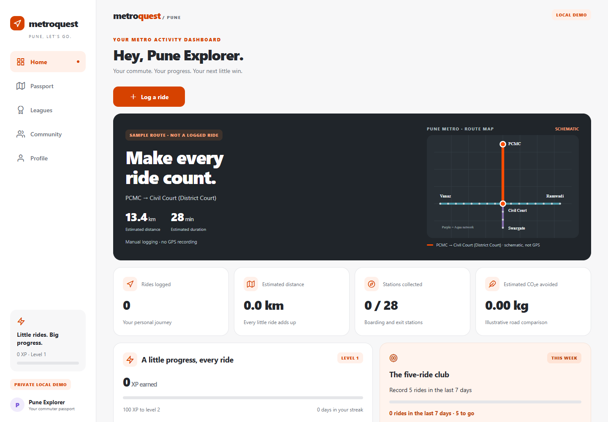

# MetroQuest · Pune

**Make every ride count.** A Strava-inspired local demo of a metro passport, journey
tracker, XP league and route community. One Expo SDK 57 application for web,
Android and iOS. Public repository: https://github.com/Roojool/pune-metro-strava.

**[Open the web demo](https://roojool.github.io/pune-metro-strava/)** ·
[Five paste-ready developer prompts](team-prompts/) · [Verified team status](TEAM_STATUS.md)



## Run

Node 24 LTS and npm are recommended. No external API keys required.

```sh
npm ci
npm run start       # Expo QR code for Android/iOS
npm run web         # Expo Web, normally http://localhost:8081
npm run typecheck
npm test
npm run export:web  # standalone static web build in dist/
```

Expo SDK 57 is deliberate during the SDK 58 transition. Install an Expo Go build
matching SDK 57; see https://expo.dev/go and the official Expo transition guidance
at https://docs.expo.dev/more/create-expo/. Android and iPhone instructions and
the exact demo scenario are in [DEMO_GUIDE.md](DEMO_GUIDE.md). Windows cannot run
the iOS simulator. Device support does not mean device testing has passed.

## What the demo does

Log PCMC → Civil Court in the quick ride screen. Shared state updates Home,
endpoint station stamps, statistics, XP and achievements. Explore sample leagues,
open a Purple Line discussion, create a local post and react. Journeys, posts,
reactions, joined communities and profile preferences persist through reload on
the same browser origin/device using AsyncStorage.

All journeys are manually self-reported. Sample identities/posts are labeled.
Rankings are local simulations, not real Pune rankings. Only boarding and exit
stations count as collected; a passed station is not a visit. No background GPS,
authentication, remote social network or ticketing is implemented.

Official station names and open status come from the [Pune Metro project
profile](https://punemetrorail.org/project-profile), checked 2026-10-24.
Range Hill is not selectable. Distances use proportional segments of the official
17.4 km Purple / 15.7 km Aqua corridors, not surveyed segment geometry. Travel time
is an estimate. Fare is unavailable; use the [official fare
checker](https://punemetrorail.org/fare_chart.aspx). Savings/CO2e use illustrative
comparison assumptions, explained in [KNOWN_LIMITATIONS.md](KNOWN_LIMITATIONS.md).

## Five humans, separate ownership

| Developer | GitHub | Branch | Exclusive files |
| --- | --- | --- | --- |
| 1 Lead | Roojool | feature/core-integration | app/**, shared core/config/tests/CI/docs |
| 2 Journeys | prathadox | feature/journey-tracking | src/features/journey/** |
| 3 Passport | chetanpujari5105 | feature/passport-stats | src/features/passport/** |
| 4 Leagues | mangeshraut712 | feature/gamification | src/features/leagues/** |
| 5 Community | atharvamhaske | feature/community-web | src/features/community/** |

Copy your complete standalone prompt:

1. [Lead / integration](team-prompts/01-lead-integration.md)
2. [Journey tracking](team-prompts/02-journey-tracking.md)
3. [Passport / statistics](team-prompts/03-passport-statistics.md)
4. [Leagues / gamification](team-prompts/04-leaderboards-gamification.md)
5. [Community / web](team-prompts/05-community-web.md)

These plans are parallel and have no overlapping feature paths. Only the lead
edits shared state/models, package configuration, root routes, shared UI or CI.
All models/calculations are central; no feature implements another scoring or
storage system. Contracts freeze at minute 20. Root routes re-export the owned
feature screens, so contributors never need to edit navigation.

The revised delivery window is **14:15–15:15 IST, 2026-10-24**. Route maps are
schematic and display manually logged trips, approximate time/distance and XP;
they are not GPS tracks. Orange activity accents pair with Purple/Aqua metro lines.

AI coding helpers use **separate worktrees and ai/* branches**. Their feature
reservations are recorded in [TEAM_STATUS.md](TEAM_STATUS.md); human owners wait
for handoff before changing an AI-reserved feature. Humans can independently
inspect, test and review. Do not run two workers in one checkout or concurrently
assign a file to a human and AI. Human accounts, invitations and branches remain
separate from AI helpers. Lead reviews, checks and squash merges one PR at a time.

See [CONTRIBUTING.md](CONTRIBUTING.md), [ARCHITECTURE.md](ARCHITECTURE.md),
[SPRINT_120_MIN.md](SPRINT_120_MIN.md), [TEAM_STATUS.md](TEAM_STATUS.md) and
[AGENTS.md](AGENTS.md). License decision: [all rights reserved](LICENSE-NOTE.md).
The Supabase SQL is an unapplied draft only.
