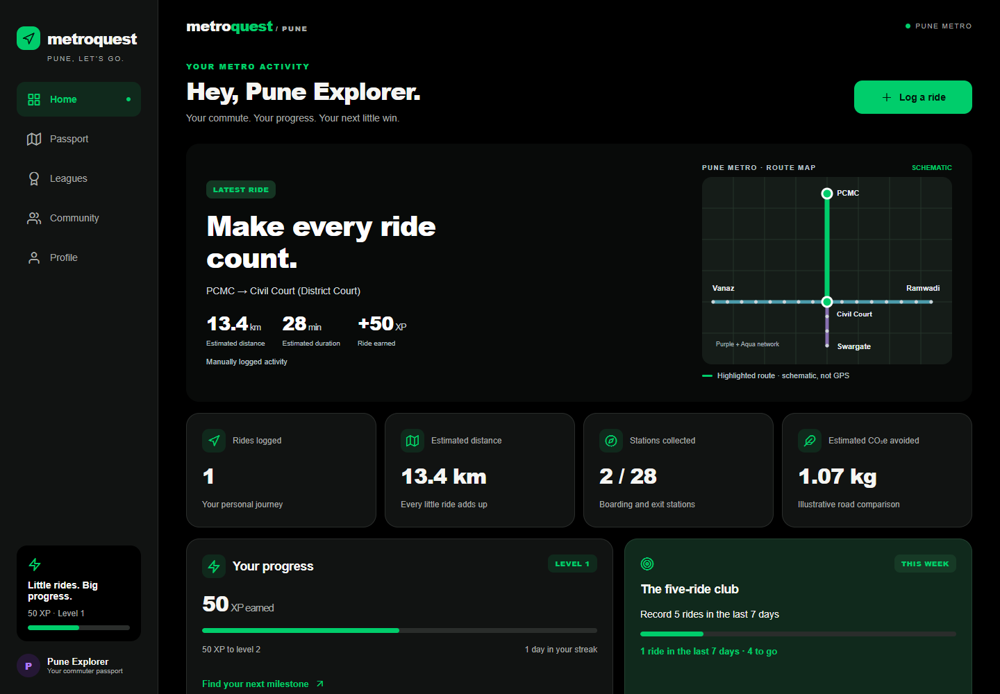
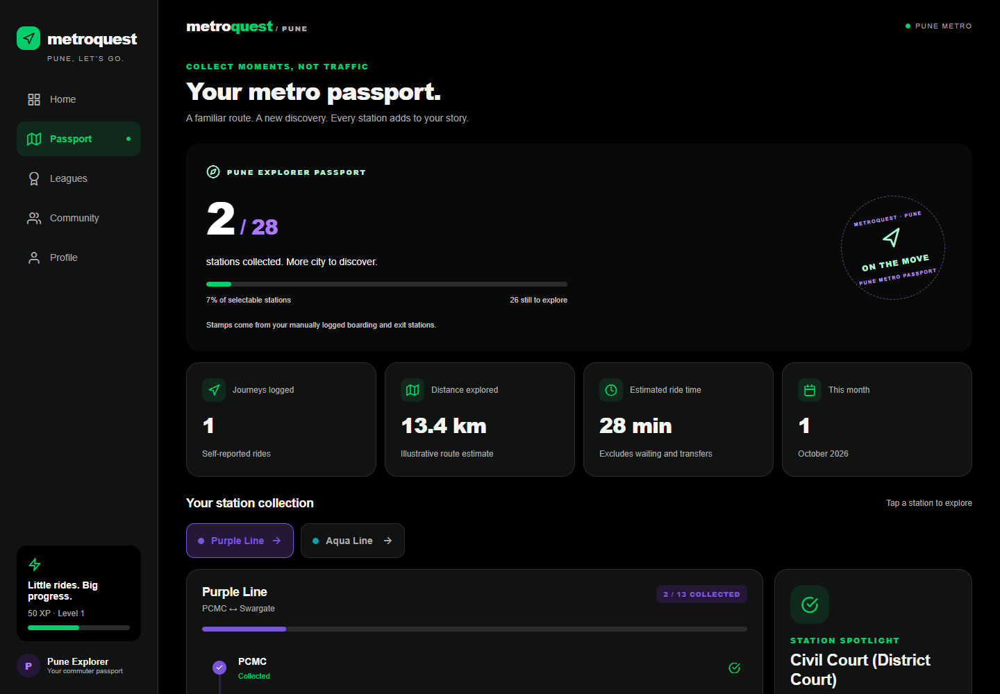
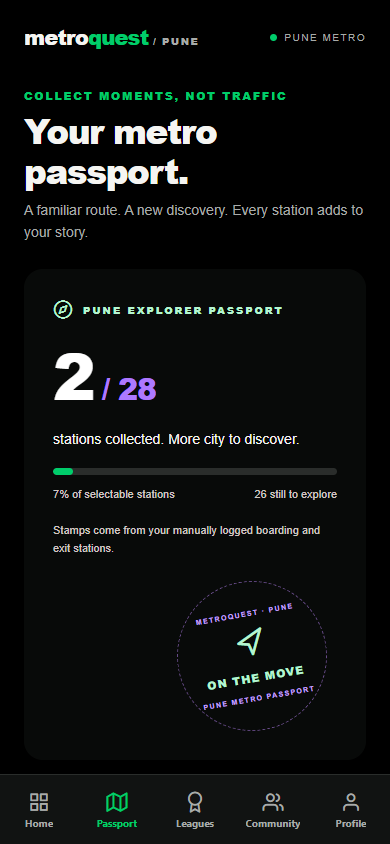

# MetroQuest — Strava for Pune Metro

**Make every ride count.** MetroQuest helps everyday Pune Metro commuters turn familiar journeys into visible progress. Log a ride, collect station stamps, earn XP and explore conversations around your metro line.

A transit habit and exploration demo for **DevDay Loops House · Urban Mobility**.

**[Open MetroQuest](https://roojool.github.io/pune-metro-strava/)** · [Pitch deck (PDF)](pitch/output/MetroQuest-Pitch-2026.pdf) · [Editable PowerPoint](pitch/output/MetroQuest-Pitch-2026.pptx)

[Ready-to-paste submission](SUBMISSION.md) · [Demo walkthrough](DEMO_GUIDE.md) · [Architecture](ARCHITECTURE.md) · [Contributing](CONTRIBUTING.md) · [Limitations](KNOWN_LIMITATIONS.md) · [Verification evidence](TEAM_STATUS.md) · [Five developer prompts](team-prompts/)

## Urban Mobility idea

MetroQuest explores whether personal progress and station discovery can make
metro travel more engaging. One Expo SDK 57, React Native, TypeScript and Expo
Router application targets web, Android and iOS. The prototype demonstrates a
connected local interaction loop; it does not establish increased ridership,
retention, congestion reduction or measured environmental impact.

## Try it in two minutes

**Home → Log PCMC→Civil Court → Passport → Leagues → Community → reload**

1. Open the [live demo](https://roojool.github.io/pune-metro-strava/) on Home.
2. Tap **Log a ride**, keep **PCMC → Civil Court**, and confirm once. The selector
   names the interchange **Civil Court (District Court)**.
3. Open **Passport**. In fresh local state, this gives **1 journey, 2 endpoint
   stamps and 50 XP**: 10 for the ride plus 20 per new endpoint. Passed stations
   are not collected.
4. Open **Leagues** and **How XP works**. Your XP comes from local rides; other
   identities and Pune/Friends/Route comparisons are **SAMPLE / DEMO**.
5. Open **Community → Purple Line**, post “Demo: exploring Pune Metro”, and react.
   The post and reaction stay in the local demo feed.
6. Reload the same browser origin and inspect the saved ride, post and reaction.

Two minutes is a presentation budget, not a measured human completion time.
Fresh state starts at zero rides and XP. Existing data changes totals; Profile's
two-step reset deletes local demo data. A one-minute cooldown and 10-ride
**UTC-day** cap limit accidental duplicates, not fraudulent travel.

## Real, sample and estimated

- **Working local behavior:** manual journeys, endpoint stamps, derived XP,
  achievements, posts, reactions, joins and profile preferences. Successful saves
  persist through AsyncStorage on the same device/browser origin.
- **SAMPLE / DEMO:** other league identities/ranks, Friends/Route scopes, seeded
  community posts and their like counts. No live city board, real friend graph,
  remote posting, accounts or cross-device sync.
- **Estimates:** schematic routes, proportional distances, approximate times and
  illustrative savings/CO₂e. Fare is unavailable; use the
  [official fare checker](https://punemetrorail.org/fare_chart.aspx).
- **Reference snapshot:** station data is based on the
  [operator project profile](https://punemetrorail.org/project-profile), recorded
  on 2026-10-24. Range Hill is unavailable in the app; this is not live service data.
- **Privacy:** rides are self-reported, never independently verified. No background
  GPS or location uploads. Optional sharing is user-initiated and aggregate-only;
  local storage is unencrypted.

No API keys, ticketing, operator affiliation or production readiness are claimed.
The Supabase SQL is an unapplied draft. See [KNOWN_LIMITATIONS.md](KNOWN_LIMITATIONS.md).

## Run and verify

Use Node 24, matching CI, and npm. No external API keys are required.

```sh
npm ci
npm run web         # use the URL printed by Expo
npm run typecheck
npm test
npm run export:web  # static build in dist/
```

`npm run verify:e2e` performs those three checks, serves a production export and
runs the ride/passport/leagues/community/reload flow in a real browser. It needs
a working Playwright CLI/browser setup and writes ignored `output/e2e-result.json`.
A passing build alone does not establish browser or native runtime success.

For native development, use `npm run start` with an SDK-57-compatible Expo Go
client; consult [Expo's download page](https://expo.dev/go). The earlier Android
API 36 / Expo Go 57.0.9 emulator pass is historical evidence. Physical phones,
iOS runtime and native share completion remain untested in the recorded handoff.
[TEAM_STATUS.md](TEAM_STATUS.md) identifies tested commits and platform limits.

## What you can do

| Feature | Experience |
| --- | --- |
| Journey tracking | Choose boarding and exit stations, preview your route, log recurring commutes and browse ride history. |
| Metro passport | Collect endpoint station stamps and explore your progress across the Purple and Aqua lines. |
| XP and achievements | Earn points, unlock milestones, complete rolling challenges and explore clearly labeled sample leagues. |
| Route communities | Browse line-based discussions, write posts, react and save group preferences on your device. |
| Travel insights | See journey totals, estimated distance and duration, and illustrative savings and CO₂e comparisons. |
| Shareable progress | Share aggregate passport and commuter cards without including your routes or travel dates. |

One Expo SDK 57 + TypeScript + Expo Router project powers the web and native
interfaces. The current prototype uses device-local persistence; sample profiles
and rankings are simulated. No external API keys are needed to try it.

## Inside the app

Actual captures of the updated interface after manually recording a presentation
ride from PCMC to Civil Court. A new installation starts at **0 rides / 0 XP**.
Earlier captures in merged [PR #21](https://github.com/Roojool/pune-metro-strava/pull/21)
show the demo at that time; later fixes may differ. Images are not usage metrics
or evidence of verified travel. Sample content stays labeled.

<div align="center">







</div>

## Platform status

| Platform | Status |
| --- | --- |
| Web | [Live on GitHub Pages](https://roojool.github.io/pune-metro-strava/); the complete journey → passport → XP → community → reload flow was browser-tested. |
| Android | Previously verified on an API 36 emulator with Expo Go 57.0.9. A standalone MetroQuest APK has not been built. |
| iOS | Bundle export verified; iPhone and simulator runtime testing have not been performed. |

The latest visual update was checked on web at desktop and mobile widths.
Earlier Android evidence: [emulator screenshot](docs/screenshots/android-home.png).
See [verification history](TEAM_STATUS.md) and [known limitations](KNOWN_LIMITATIONS.md).

## Team and ownership

- **Roojool — lead**, `feature/core-integration`: app routes, shared core,
  configuration, tests, CI, scripts, assets and documentation.
- **prathadox — Journey**, `feature/journey-tracking`: `src/features/journey/**`.
- **chetanpujari5105 — Passport**, `feature/passport-stats`: `src/features/passport/**`.
- **mangeshraut712 — Leagues**, `feature/gamification`: `src/features/leagues/**`.
- **atharvamhaske — Community**, `feature/community-web`: `src/features/community/**`.

Leagues [#16](https://github.com/Roojool/pune-metro-strava/pull/16) and
[#24](https://github.com/Roojool/pune-metro-strava/pull/24), habit/progress follow-up
[#31](https://github.com/Roojool/pune-metro-strava/pull/31), screenshots
[#21](https://github.com/Roojool/pune-metro-strava/pull/21), Journey #23, Passport
#26 and Community follow-up #29 are merged. [TEAM_STATUS.md](TEAM_STATUS.md)
distinguishes human ownership from helper contributions.

Only the lead changes shared contracts, frozen at **14:18 IST on 2026-10-24**.
Feature workers use assigned folders; AI helpers use separate `ai/*` branches
**and worktrees**. One editor per checkout, disjoint delegated files, no force
pushes and no direct main pushes by feature workers.

Read [CONTRIBUTING.md](CONTRIBUTING.md), [AGENTS.md](AGENTS.md),
[ARCHITECTURE.md](ARCHITECTURE.md) and your [role prompt](team-prompts/).
[INTEGRATION_BOARD.md](INTEGRATION_BOARD.md) is the dated handoff;
[SPRINT_120_MIN.md](SPRINT_120_MIN.md) preserves the historical plan.
The [continuation guide](docs/TEAM_CONTINUATION.md) applies to assigned integration
work. A bounded docs-only assignment stops at its requested PR checkpoint and
does not claim merged E2E completion.

[Documentation inventory](docs/DOCUMENTATION_INVENTORY.md) ·
[License note: all rights reserved](LICENSE-NOTE.md). Public visibility does not
make the repository open source.
